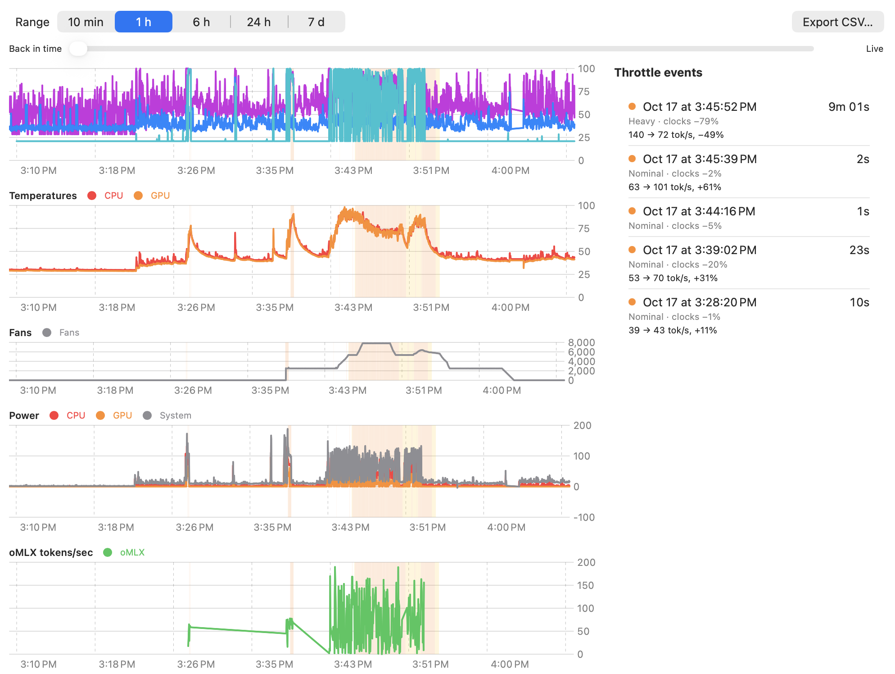

# ThermalWatch

A macOS menu-bar app that shows when your Apple Silicon Mac is being thermally throttled, and how much it is costing you.

It was built to answer one question on a 14-inch MacBook Pro (M5 Max): *when a local AI model slows down, is it the heat?*
ThermalWatch samples the chip once a second, colors the menu-bar icon by state, keeps a week of history, and
can overlay tokens/sec from a local [oMLX](https://github.com/jundot/omlx) server on the same timeline.

Everything runs locally. No `sudo`, no helper daemon, no network access beyond an optional loopback call to oMLX.



*One hour of history on an M5 Max. The shaded stretch is a 9-minute throttle event at Heavy pressure, during which oMLX fell from 140 to 72 tokens/sec.*

## Features

- **Always-on glance** — a chip icon in the menu bar with a colored dot (green / yellow / orange / red). Optionally shows the hottest die temperature next to it.
- **Popover** — current state, thermal pressure, clock speed of each core group and the GPU as a share of peak, CPU/GPU temperatures, fan speeds, system power, oMLX tokens/sec, a 10-minute sparkline, and time throttled today.
- **History window** — charts for clocks, temperatures, fans, power and tokens/sec over 10 minutes up to 7 days, with throttled stretches shaded on every chart, a list of throttle events, and CSV export.
- **Alerts** — a notification when thermal pressure reaches Heavy, or when clocks have been held down for 30 seconds (at most one every 10 minutes).
- **Built-in load test** — a CPU, GPU or CPU + GPU burn for 5, 10 or 20 minutes that records how fast the chip throttles, how far clocks drop, and peak temperatures, so you can compare runs (desk vs. cooling stand, Low Power Mode, and so on). It stops automatically if a die passes 105 °C, and warns you first if oMLX is generating.

## How throttling is detected

Each sample is one of **Cool**, **Warm** or **Throttled**:

| State | Rule |
|---|---|
| **Throttled** | macOS thermal pressure is Moderate or higher, **or** clocks are being held down. |
| Clocks held down | A core group or the GPU has been busy (over 60%) for at least 5 seconds but is running below 85% of its peak, **or** the GPU's own thermal limiter (`GPU_CLTM`) is engaged. |
| **Warm** | A die is above 95 °C, or clocks are 5% or more below peak. |
| **Cool** | Neither of the above. |

"Peak" is the fastest clock seen while busy over the last 7 days, falling back to the chip's rated maximum.
A throttle event ends 10 seconds after the last throttled sample.

### Reading the colors

The same colors are used for the menu-bar dot and the shaded bands on the charts:

| Color | Meaning |
|---|---|
| Green | Cool. |
| Yellow | Moderate thermal pressure without clocks being held down (bands), or Warm (menu-bar dot only). A warning, usually no speed lost yet. |
| Orange | Clocks held down, or Heavy pressure. Real throttling: the chip is running slower than it can. |
| Red | Critical pressure or worse. |

On the Clocks chart, 100% is peak speed. A line dropping *while that part is busy* is throttling; dips while idle are just the chip saving power.

## Where the numbers come from

All sources work without root:

| Data | Source |
|---|---|
| Thermal pressure | `notify` key `com.apple.system.thermalpressurelevel` |
| Clock residency and GPU thermal cap | IOReport (private framework, loaded with `dlopen`) |
| Frequency tables | `pmgr` `voltage-states*` properties in the IORegistry |
| Temperatures, fans, CPU and system power | AppleSMC user client |
| GPU power | IOReport Energy Model |
| Tokens/sec | oMLX `GET /admin/api/activity` (optional) |

IOReport and SMC are undocumented, so a macOS update can break individual readings. When a source fails, ThermalWatch keeps running and lists it under "Unavailable" in the popover.

## Requirements

- Apple Silicon Mac. Developed and tested on an M5 Max (6 Super + 12 Performance cores); other chips should work but the core-group mapping may need adjusting.
- macOS 27 or later.
- Xcode 27 / Swift 6.4 toolchain to build.

## Build and install

```bash
./build.sh            # builds .build/ThermalWatch.app
./build.sh --install  # also copies it to ~/Applications and launches it
```

The app is ad-hoc signed unless a code-signing identity named `KonaClaw Dev` exists in your keychain. A stable
self-signed identity keeps the notification permission across rebuilds; edit `IDENTITY` in `build.sh` to use your own.

Run the tests:

```bash
swift test
```

There is also a small command-line probe that prints raw sensor readings:

```bash
swift run thermalwatch-probe
```

## Settings

- Launch at login (on by default)
- Show the hottest chip temperature in the menu bar
- Keep history for 1–30 days (default 7)
- Turn each alert on or off, and send a test notification
- oMLX server URL (default `http://127.0.0.1:8901`), plus an optional env file and variable name for an API key. oMLX on localhost needs no key.

History is stored in SQLite at `~/Library/Application Support/ThermalWatch/history.sqlite`.

## Project layout

| Target | Contents |
|---|---|
| `ThermalCore` | Sample model, throttle detection, events, alerts, history store, downsampling, CSV export |
| `ThermalSensors` | IOReport, SMC, pmgr, thermal pressure and oMLX readers |
| `ThermalLoad` | CPU and Metal GPU load generators for the load test |
| `ThermalWatchApp` | SwiftUI menu-bar app, charts, settings and load-test UI |
| `ThermalProbe` | `thermalwatch-probe` command-line tool |

The design spec and implementation plan are in [`docs/`](docs/).

## License

[MIT](LICENSE)
